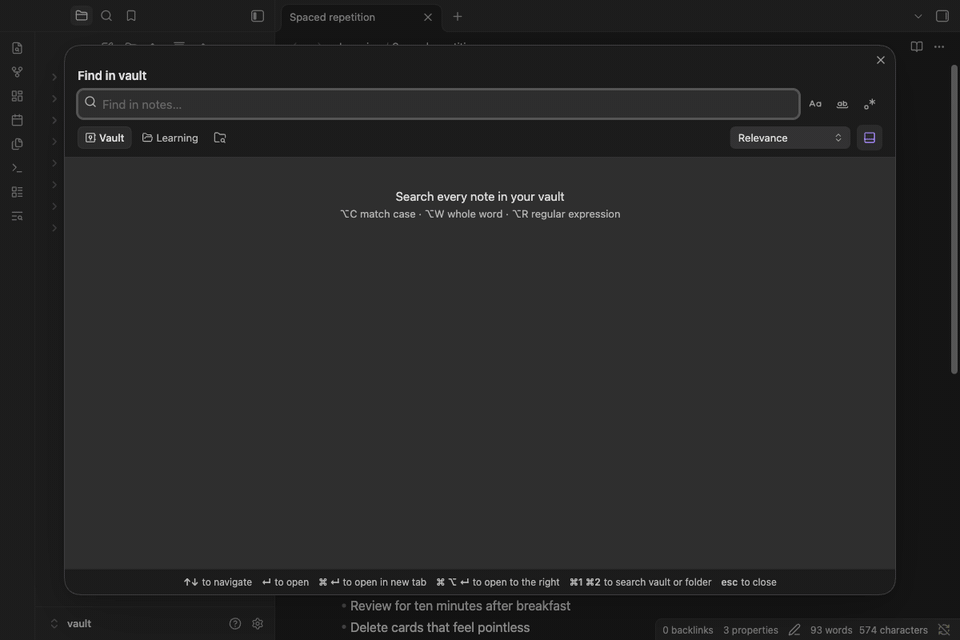
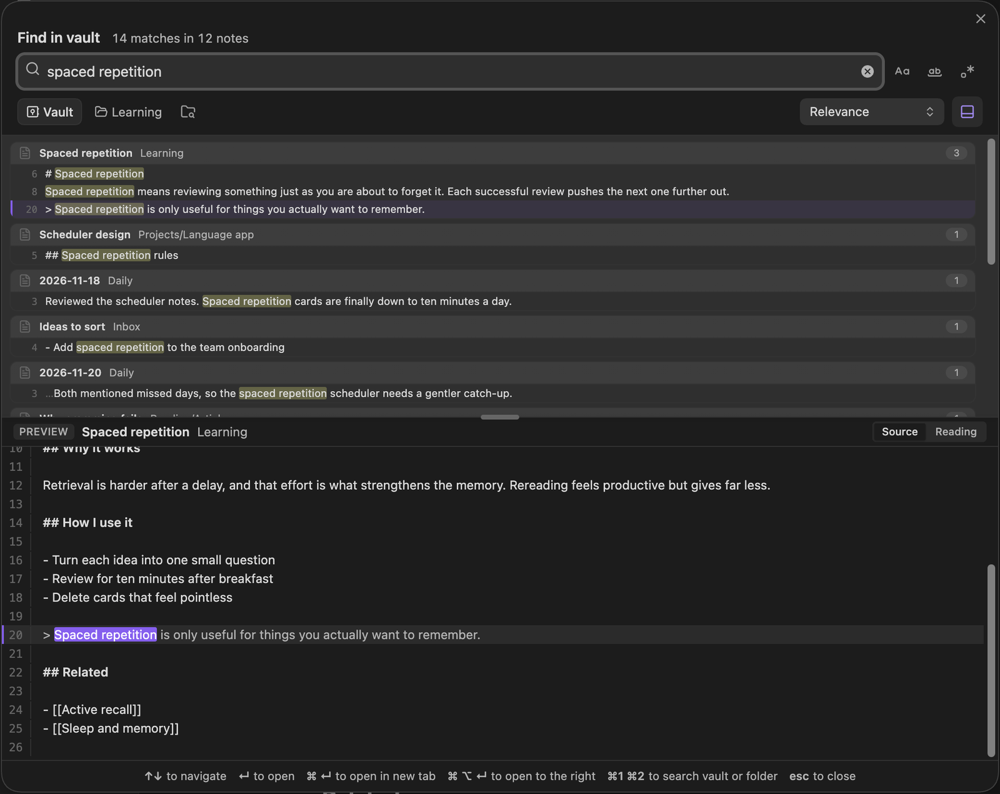
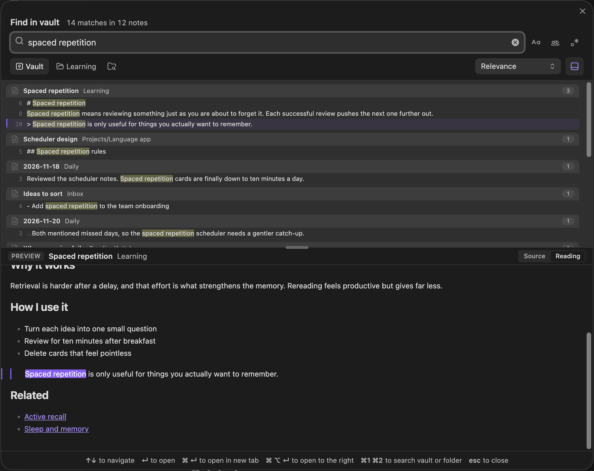
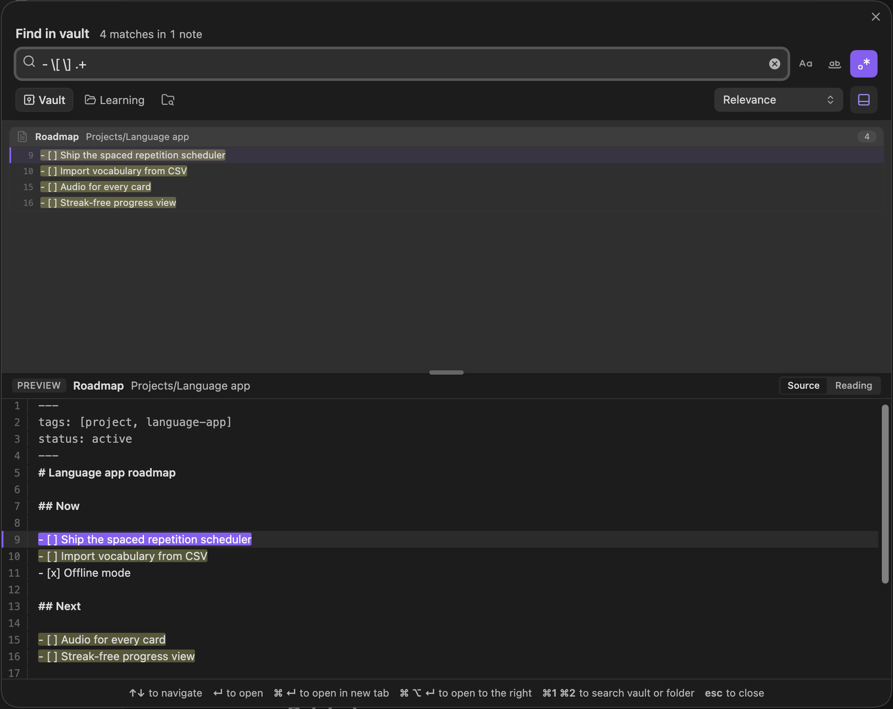
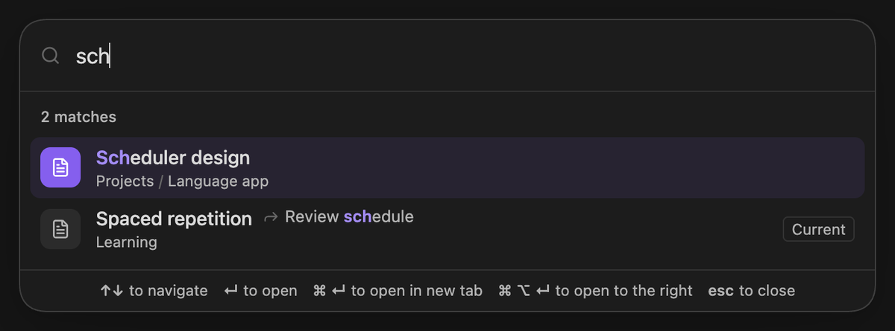
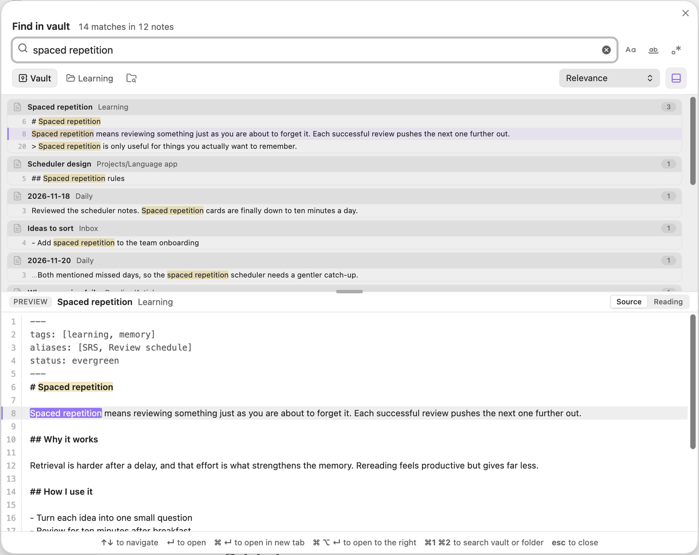
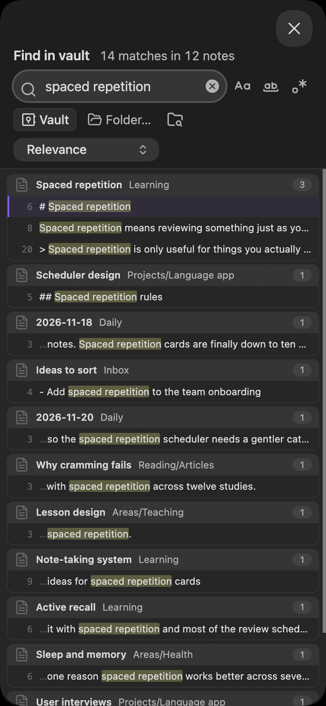

# Needle

Find any text in your vault, see it in context, and jump straight to it.

Needle brings the "Find in Files" panel from code editors to Obsidian. Type a word, phrase or regular expression and you get every matching line, grouped by note, with a live preview of the note underneath. You can check each match without opening anything.

## Why use it

- **See every match, not just every note.** Each line that matches is listed with its line number.
- **Read before you open.** Arrow through results and the preview follows, in source or reading view.
- **Best notes first.** Results are ranked by title, headings, properties, frequency and how recently you edited the note.
- **Stays out of your way.** Search runs in the background, so a huge vault or a bad regex won't freeze Obsidian.
- **Private and read-only.** Needle never changes your notes and makes no network requests.

## Features

### Find in vault

Search the whole vault or a single folder, with toggles for match case, whole word and regular expressions. Drag the window edges or the divider to get the layout you like, and Needle remembers it.

### Preview in reading view

Press <kbd>Ctrl/Cmd</kbd>+<kbd>E</kbd> to see the note rendered, with your matches still highlighted.

### Regular expressions

Useful for finding things plain search can't, like every open task in your vault. The [guide](docs/guide.md#regex-recipes) has patterns you can copy.

### Go to note

A quick switcher that puts the title first and the folder underneath, so notes with the same name are easy to tell apart. It matches titles, aliases and folders, and with nothing typed it lists your recent notes.

### Light, dark and mobile

Needle uses your theme's colors, so it fits in with light, dark and community themes. On phones it goes full screen.

  
  

## Getting started

1. In Obsidian, open **Settings → Community plugins → Browse**.
2. Search for **Needle**, then install and enable it.
3. Run **Needle: Find in vault** from the command palette, or click the search icon in the ribbon.

Needle doesn't set any hotkeys for you. Most people will want these, under **Settings → Hotkeys**:

| Command | Suggested hotkey | Replaces |
| --- | --- | --- |
| Needle: Find in vault | <kbd>Ctrl/Cmd</kbd>+<kbd>Shift</kbd>+<kbd>F</kbd> | Search: Search in all files |
| Needle: Go to note | <kbd>Ctrl/Cmd</kbd>+<kbd>O</kbd> | Quick switcher: Open quick switcher |

Remove the shortcut from the core command first so the two don't clash.

You can also right-click a folder and choose **Find in folder**, or select text in a note and choose **Find in vault**.

## Keyboard shortcuts

| Key | Action |
| --- | --- |
| <kbd>↑</kbd> <kbd>↓</kbd> | Move through matches |
| <kbd>Page Up</kbd> <kbd>Page Down</kbd> | Move ten matches at a time |
| <kbd>Enter</kbd> | Open the note at the match |
| <kbd>Ctrl/Cmd</kbd>+<kbd>Enter</kbd> | Open in a new tab |
| <kbd>Ctrl/Cmd</kbd>+<kbd>Alt</kbd>+<kbd>Enter</kbd> | Open to the right |
| <kbd>Alt</kbd>+<kbd>C</kbd> / <kbd>W</kbd> / <kbd>R</kbd> | Toggle match case, whole word, regex |
| <kbd>Ctrl/Cmd</kbd>+<kbd>1</kbd> / <kbd>2</kbd> | Search the vault / the folder |
| <kbd>Ctrl/Cmd</kbd>+<kbd>E</kbd> | Switch between source and reading preview |
| <kbd>Esc</kbd> | Close |

## Privacy

Needle only reads your notes. It doesn't write, rename or delete them, makes no network requests and collects no data. The only thing it saves is its own settings, in the plugin's `data.json`.

## Limitations

- It searches Markdown notes only, and skips notes over 10 MB.
- There is no find and replace.
- In the reading preview, footnotes and reference-style links that point to another section don't resolve.

## More

- [User guide](docs/guide.md): search options, ranking, settings, regex recipes and troubleshooting
- [Changelog](CHANGELOG.md)
- [Contributing](CONTRIBUTING.md)

Found a bug or have an idea? [Open an issue](../../issues).

## License

[MIT](LICENSE)
